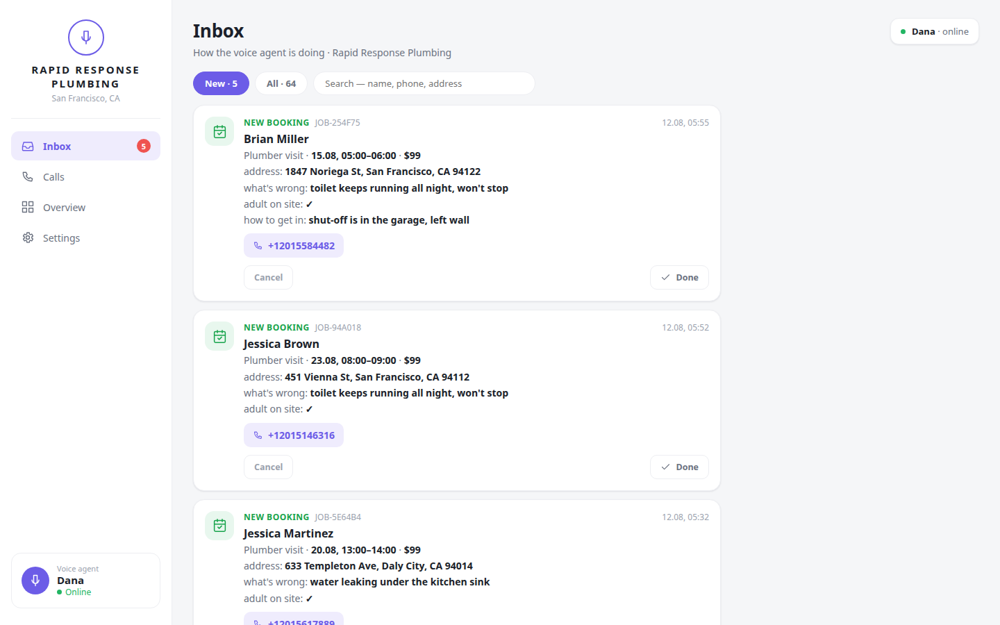
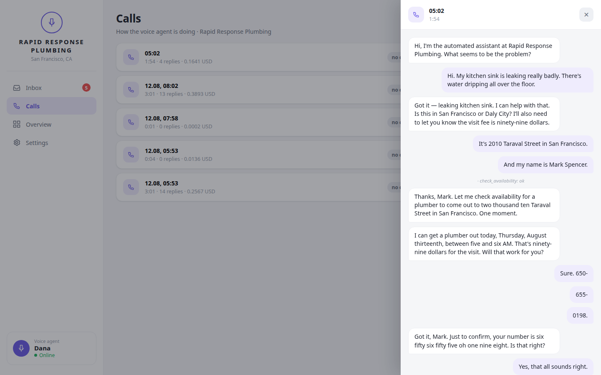
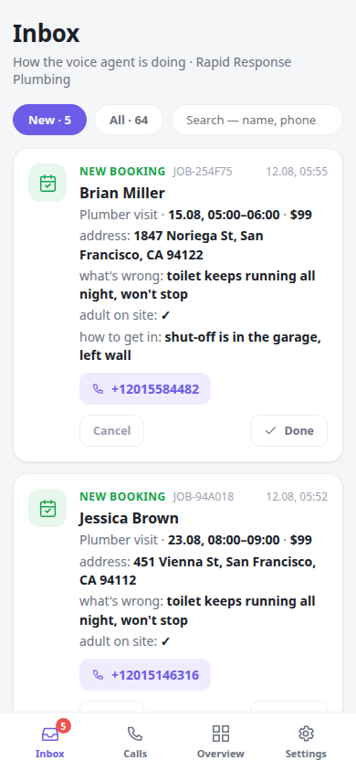

# open-receptionist

[](https://github.com/andriidrok1/open-receptionist/actions/workflows/tests.yml)

A self-hosted voice receptionist for small businesses. Someone calls, talks to
it normally, and it answers questions about the business, books the
appointment, and honestly hands off anything it doesn't know.

**[▶ Listen to a call](docs/demo-call.mp3)** — an emergency plumbing shop,
recorded through the telephony pipeline (8 kHz μ-law, the codec of a real
phone line). Everything the agent did during that call landed here:



One YAML file describes one business. The core knows nothing about any industry:

```bash
BUSINESS=emergency_us python bot.py   # 24/7 emergency plumber (English)
BUSINESS=dental_us    python bot.py   # dental practice (English)
BUSINESS=hotel        python bot.py   # hotel — bookings by the night (Ukrainian)
BUSINESS=clinic       python bot.py   # clinic (Ukrainian)
BUSINESS=cleaning     python bot.py   # cleaning service — visits with an address
BUSINESS=barbershop   python bot.py   # barbershop
BUSINESS=emergency    python bot.py   # emergency plumber (Ukrainian)
```

A new business is a new file in `server/businesses/`. No code is touched —
there is [a commented template and a 20-question owner interview
sheet](docs/new-business.md) that turn one conversation with the owner into a
working config.

Built on [Pipecat](https://github.com/pipecat-ai/pipecat). You bring your own
speech-to-text, LLM and text-to-speech keys and pay those providers directly.
Nothing sits in between charging you per minute.

Українською: [docs/README.uk.md](docs/README.uk.md).

---

## Status — please read before you clone

This is honest, not modest. Here is exactly where it stands today.

**Works, and has been used in real conversations**

- Full voice conversation in the browser (WebRTC) and over the telephony
  pipeline, in English and Ukrainian — the language is a config line, and the
  whole language pack (prompt, tool errors the model reads, phone formats,
  month names, dashboard labels) follows it
- Seven business configs across five verticals, two languages
- Booking with availability, capacity, working hours, service-area checks and
  required intake fields — enforced in code, not requested in the prompt
- **Twilio**: a real US number connected through the standard webhook + Media
  Streams flow, and a wire-accurate simulated caller
  ([`server/phone_sim.py`](server/phone_sim.py)) exercises the full 8 kHz
  path — see [docs/telephony.md](docs/telephony.md)
- An owner dashboard that is an inbox first, stats second (screenshots below)
- Telegram push to the owner: bookings, cancellations and messages land on
  their phone, at-least-once, with a two-minute self-hosted setup
- Measured cost: **≈ $0.09 per spoken minute** all-in (breakdown below)
- Every call traced per turn — where the caller's wait went (timer, STT,
  first token, tools, TTS), what the tools did, what broke, what it cost —
  to a JSONL file, with a report tool over a folder of them
  ([Observability](#observability))
- 440+ tests, plus two conversation harnesses (scripted and an LLM playing
  difficult callers)

**In progress, and not there yet**

- A full spoken call over carrier audio and the REST hang-up — the simulated
  call passes end to end; one live phone call remains to prove the last mile
- Telnyx / Plivo share the Twilio code path and are untested on real numbers
- The Telegram push has not yet been run against a live bot token — the
  delivery, pairing and stamp semantics are covered by tests, the last-mile
  HTTP is not

**Not planned**

Multi-tenancy, billing, a hosted service, CRM/PMS integrations, an owner
mobile app. One install serves one business; the dashboard is a web page.

---

## Who this is for

**People building AI receptionists for local businesses.** Configure a client
in one file, install with one `docker compose up`, keep the margin instead of
paying a platform a cut of every minute forever. The
[install guide](docs/install.md) is written for exactly this workflow —
including what to hand the owner at the end.

**A business that wants to own the thing answering its phone.** Your call
recordings, your customer list and your per-minute cost live on your server,
under keys you hold. No vendor deciding what happens to them or what next
year's pricing is.

**Engineers.** Everything below the fold is about the parts that are not in
any tutorial — see [The hard parts](#the-hard-parts-already-solved).

---

## Quickstart

Requires an OpenAI key and an ElevenLabs key. Two ways in:

**Docker** (how a real install runs — agent + dashboard sharing one database):

```bash
git clone https://github.com/andriidrok1/open-receptionist.git && cd open-receptionist
cp server/.env.example server/.env   # add the two keys
docker compose up -d --build
```

**Bare Python** (Python 3.11+, better for hacking on it):

```bash
python -m venv .venv && source .venv/bin/activate
pip install -r server/requirements.txt
cd server && cp .env.example .env && python bot.py
```

Either way: open <http://localhost:7860/client>, hit **Connect**, allow the
microphone, talk.

To see all the businesses side by side on one page:

```bash
cd server && python run_demo.py     # → http://localhost:8080
```

That page is the one you show a business owner: their prices and hours, a call
button, a live transcript, and — the part that sells it — the booking that
just appeared in the database.

**A real phone number** is one config page away: [docs/telephony.md](docs/telephony.md).
**A production install for a client**, start to finish: [docs/install.md](docs/install.md).

---

## The owner's dashboard

The owner opens it with one question — *"what happened while I wasn't looking,
and whom do I owe a call?"* — so the first screen is an inbox: bookings,
cancellations and callback requests, each with a checkmark to flip once dealt
with. Charts live on a separate tab, because charts are what you look at
monthly, not daily.

| The conversation, one tap away | On the owner's phone |
|---|---|
|  |  |

- **Calls** — every conversation with its transcript, duration, what it cost,
  and what came out of it (a booking, a message, or nothing).
- **Settings → duty schedule** — the owner picks the hours they answer the
  phone *themselves*; the agent covers nights, weekends and everything else.
  Applies from the very next call, no restart.
- **The status dot is measured, not painted** — it probes the agent's port and
  distinguishes "process down" from "paused for the owner's shift".
- **Access**: set `DASHBOARD_PASSWORD` and the page works from the owner's
  phone (signed 30-day sessions; rotating the password signs every browser
  out). With no password it answers to localhost only — an open page full of
  customers' phone numbers is a leak, not a convenience.
- The dashboard is React served as static files, vendored — a self-hosted
  install pulls nothing from a CDN and the customer-data page phones no one.

---

## What a minute costs

Measured across our recorded test calls — 12 calls, 20 minutes of
conversation, mixed verticals — with the per-call breakdown stored alongside
every call (`metrics.cost`, priced from
[`server/pricing.yaml`](server/pricing.yaml)):

| | |
|---|---|
| All-in average | **$0.090 / minute** |
| Range across calls | $0.03 – $0.13 / minute |
| Where it goes | ~80% ElevenLabs TTS, then STT, then the LLM (~4%), then Twilio (~$0.01/min) |

A receptionist that talks two hours a month costs about $11 in usage. The TTS
share is the lever: OpenAI voices instead of ElevenLabs cut the bill several
times over, at a real cost in voice quality — and both are one `.env` line.

---

## How it works

```
mic / phone → Silero VAD → ElevenLabs Scribe STT → OpenAI LLM → ElevenLabs TTS → out
                                                     ↓
                                           tools: check availability,
                                           create booking, take message
                                                     ↓
                                               SQLite + dashboard
```

| file | what it owns |
|---|---|
| `server/bot.py` | pipeline, voice, transport (browser / phone). Nothing industry-specific |
| `server/business.py` | reads the business YAML, assembles the system prompt |
| `server/businesses/*.yaml` | **the entire business lives here**: persona, knowledge, services, prices, hours |
| `server/agent_tools.py` | the agent's tools, built from the config — one code path for the bot and the tests |
| `server/crm.py` | bookings, messages, availability, validation, the owner's inbox |
| `server/dashboard.py` | the owner's panel (auth, API; the UI is `server/static/`) |
| `server/guards.py` | catches the model lying — see below |
| `server/demo.py`, `run_demo.py` | the showcase page you show a business owner |
| `server/phone_sim.py` | a caller arriving the way Twilio delivers one, without the phone bill |
| `server/eval.py`, `server/simulate.py` | the test harnesses |
| `server/observability.py`, `server/call_report.py` | the per-call trace and the report over it |

### Two time models cover almost every receptionist

- **`nights`** — booking a range of days. The customer sets the bounds
  (check-in, check-out), price is per night × number of nights. Hotels,
  apartments, rentals.
- **`slots`** — an appointment at a specific time. The service sets the bounds
  (duration comes from the config), price is flat. Clinics, barbershops,
  garages, tutors.

Both reduce to the same thing: a resource is occupied over `[start, end)` and
can be occupied at most `capacity` times at once. One SQL query for overlap,
one code path — not two parallel branches of business logic.

A business with no bookings at all (`booking.enabled: false`) still gets
answers and callback requests. That is a working receptionist too.

---

## Describing a business

This is the whole point of the project, so here is a real config, trimmed. It
is in Ukrainian, which is also the proof that this is not an English-only
system.

```yaml
name: стоматологія «Дентал Сіті»       # how the agent says the business name out loud
agent_name: Оксана                      # the agent's name
persona: адміністратор клініки          # "receptionist at a dental practice"

speech:                                 # the same thought written vs. spoken
  bad:  Отже, консультація лікаря-стоматолога у вівторок…
  good: Так, у вівторок о десятій вільно. Консультація — триста гривень. Записую?

knowledge: |                            # everything the agent is allowed to know
  Послуги й ціни: Консультація — 300 грн (30 хв)…

booking:
  granularity: slots
  hours: {mon: "09:00-19:00", sat: "10:00-15:00", sun: null}
  resources:
    - key: consult
      label: Консультація
      aliases: [консультацію, огляд, подивитися зуб]   # how people actually say it
      price: 300
      duration_min: 30
      capacity: 2                       # how many dentists cover this service at once
```

`aliases` are not decoration: a caller says "come look at my tooth", not
"consultation". `speech.bad` / `speech.good` are not decoration either — the
model copies the example it is given, so the example has to be in this
business's own voice, not a generic one.

Every field, commented: [`server/businesses/_template.yaml`](server/businesses/_template.yaml).
The questions that fill it in one sitting with the owner:
[docs/new-business.md](docs/new-business.md).

---

## The hard parts, already solved

None of this is in any tutorial. Every item cost a live debugging session.

**The model confirmed a booking no tool ever made.** On a phone-pipeline test
call the caller rushed the goodbye — "yes, that's right, thanks, bye" in one
breath — and the model answered with a confident confirmation and an invented
reference number, without calling `create_booking`. A guard now cross-checks
every reply that claims a booking against what the tools actually did, and
replaces the lie before the TTS speaks it. A receptionist that files nothing
is a bug; one that *says it filed* and didn't is the end of the owner's trust.

**The bot heard itself.** With manual commit, everything the microphone picks
up between commits is attributed to the caller — and a commit only happens
when the caller stops talking. Echo from the speakers (quiet enough that local
VAD ignores it, loud enough that Scribe transcribes it perfectly) ended up in
the context as the caller's words. Measured: the bot's own line came back as
the human's. Fixed by muting the STT input while the bot speaks. **On a phone
line, where there is no browser echo cancellation, this is not an edge case —
it is guaranteed.**

**Interim transcripts interrupted the bot mid-sentence.** The default
turn-start strategy treats any partial transcript as the user starting to
talk, which broadcasts an interruption. With manual commit no final transcript
follows, so the turn hangs until a 5-second watchdog closes it empty and the
LLM never runs. It sounds exactly like a dropped connection.

**A slow first byte from TTS dropped the entire reply.** If the synthesiser
takes longer than the default 3 seconds to return audio, the whole utterance
is discarded silently — and the service stays paused until the next
interruption. Not a stutter: silence for the rest of the turn.

**One ElevenLabs keyterm longer than 20 characters closes the whole socket.**
Not ignored — closed, with code 1008. It looks like "speech recognition is
completely broken": audio flows, VAD fires, no transcripts ever arrive.
Service names are pulled from the config, so two of five businesses were dead
and three were fine.

**Sentence-by-sentence synthesis sounds like three announcements.** Pipecat
synthesises each sentence as it arrives, which is the lowest latency but
builds intonation inside one sentence — the price lands flat and the closing
question doesn't sound like a question. `WholeReplyAggregator` holds the reply
and synthesises it in one piece. It costs about 0.7 s of latency.

**Anything deterministic belongs in code, not in the prompt.** Phone format,
real names instead of placeholders, times in the past, closing hours,
overbooking, "an adult must be home" — the model will violate every one of
these politely and confidently. The tools return errors the model can read out
loud, and a `spoken` string it just recites, because when it computed the
numbers itself it said one date and stored another.

---

## Testing

```bash
python -m pytest server/tests   # the deterministic suite: no network, no keys
python eval.py --business all   # scripted dialogues against the real model
python simulate.py --show       # an LLM plays the caller: mumbles, changes its
                                # mind, gives a wrong number, asks for the past
python phone_sim.py             # a Twilio-shaped caller over a real websocket,
                                # records the call to a stereo WAV
```

`simulate.py` checks things that do not depend on the scenario: did the agent
invent data the caller never gave, promise a slot the tools never confirmed,
claim it booked something when it didn't, or ask the same question three
times.

---

## Observability

Every call leaves `server/logs/calls/<call_id>.jsonl` — the same id as the
transcript in the dashboard — one JSON row per moment of the call, written as
it happens (a call that dies mid-way still leaves its trace):

```json
{"t": 0.001, "ts": "2026-09-29T22:10:39.433+00:00", "call_id": "demo00", "event": "user_stopped", "turn": 1}
{"t": 0.001, "ts": "2026-09-29T22:10:39.433+00:00", "call_id": "demo00", "event": "transcript", "turn": 1, "chars": 40}
{"t": 0.602, "ts": "2026-09-29T22:10:40.034+00:00", "call_id": "demo00", "event": "turn_closed", "turn": 1}
{"t": 0.603, "ts": "2026-09-29T22:10:40.034+00:00", "call_id": "demo00", "event": "llm_started", "turn": 1, "run": 1}
{"t": 1.805, "ts": "2026-09-29T22:10:41.236+00:00", "call_id": "demo00", "event": "llm_first_token", "turn": 1, "run": 1}
{"t": 1.805, "ts": "2026-09-29T22:10:41.236+00:00", "call_id": "demo00", "event": "usage", "kind": "llm", "processor": "llm", "prompt_tokens": 500, "completion_tokens": 20}
{"t": 1.805, "ts": "2026-09-29T22:10:41.236+00:00", "call_id": "demo00", "event": "llm_done", "turn": 1, "run": 1}
{"t": 1.805, "ts": "2026-09-29T22:10:41.236+00:00", "call_id": "demo00", "event": "tts_started", "turn": 1}
{"t": 2.407, "ts": "2026-09-29T22:10:41.838+00:00", "call_id": "demo00", "event": "tts_first_audio", "turn": 1}
{"t": 2.407, "ts": "2026-09-29T22:10:41.838+00:00", "call_id": "demo00", "event": "usage", "kind": "tts", "processor": "tts", "characters": 10}
{"t": 2.407, "ts": "2026-09-29T22:10:41.838+00:00", "call_id": "demo00", "event": "bot_started", "turn": 1}
{"t": 3.608, "ts": "2026-09-29T22:10:43.040+00:00", "call_id": "demo00", "event": "bot_stopped", "turn": 1}
```

The rows a turn produces, in order: `user_stopped` (VAD), `transcript` (the
STT's final text), `turn_closed` (our end-of-turn timer expired),
`llm_started` / `llm_first_token` / `llm_done` per model run, `tool_started` /
`tool_done` (name, duration, `ok` / `rejected` / `failed` — *rejected* is the
tool saying no in a sentence the model reads out, which is the receptionist
working), `tts_started` / `tts_first_audio`, `bot_started` / `bot_stopped`,
`interrupted`. Plus `usage` (tokens, characters), `ttfb` as each service
reports it, and `error`. The last row is `call_ended` with the call's summary.

From those come the numbers per turn: **latency** = from the caller's last
silence to the first sound of the reply, which is the one they feel, and the
stages that explain it (they overlap on purpose — the STT runs under the
timer — so they do not add up, and that is the point: a stage that overlaps
costs nothing). Cost reuses [`pricing.yaml`](server/pricing.yaml) through the
same code as the per-call metrics; without that file the usage is reported and
the money is not guessed.

When a call ends, one line lands in the main log:

```
[trace demo00] emergency_us · 32.2s · 4 turns · latency p50 2.41s p95 4.21s (stt 0.00 · llm 1.20 · tts 0.60) · 1 tool calls · 0 errors · $0.015 ($0.027/min) · logs/calls/demo00.jsonl
```

And over a folder of calls:

```bash
cd server && python call_report.py                 # logs/calls/, every call
python call_report.py --business dental_us --last 50 --calls
python call_report.py --json                       # the same, for machines
```

```
calls            5 (5 completed, 0 cut)   emergency_us ×2 · dental_us ×2 · clinic ×1
talk time        2.6 min total · 32s median per call
turns            20 (5 with a tool call) · 0 interrupted

latency (caller stops → bot speaks)         p50    p95    max     n
  all turns                                2.41   4.21   4.21    20
  plain                                    2.41   2.41   2.41    15
  with a tool call                         4.21   4.21   4.21     5
stages (seconds)                            p50    p95    max     n
  end-of-turn timer                        0.60   0.60   0.60    20
  stt final transcript                     0.00   0.00   0.00    20
  llm first token                          1.20   3.00   3.01    20
  llm total (all runs)                     1.20   3.00   3.01    20
  tools                                    0.60   0.60   0.60     5
  tts first audio                          0.60   0.60   0.60    20

tools                             calls    ok  rejected  failed   p50 s
  check_availability                  5     5         0       0    0.60

errors           1
  ?: connection to Scribe was closed  ×1

usage            10000 in + 400 out tokens, 200 synthesised characters
cost             0.071 USD total · 0.015 median per call · 0.027/min   (rates checked 2026-08-10)
  of which       tts 42% · stt 24% · llm 2% · phone 31%

call          business      started                    s turns    p50    p95 tools err    cost
demo00        emergency_us  2026-09-29 22:10:39       32     4   2.41   4.21     1   0   0.015
demo01        dental_us     2026-09-29 22:11:11       23     3   2.41   4.21     1   0   0.011
demo02        emergency_us  2026-09-29 22:11:34       38     5   2.41   4.21     1   0   0.018
demo03        clinic        2026-09-29 22:12:12       16     2   2.40   4.21     1   1   0.007
demo04        dental_us     2026-09-29 22:12:28       46     6   2.41   4.21     1   0   0.021
```

Those numbers are from five synthetic calls produced by the test harness (a
fake cascade with fixed delays, no provider behind it) — the shape is real,
the timings are the harness's. On a live call the same rows come from the
real STT, model and synthesiser.

It hooks in as a Pipecat *observer* on the worker, not as a processor in the
pipeline: nothing about the pipeline changes, and the observer is told about
every frame at its first push, which is the moment closest to the event. (A
processor only sees what reaches its position — the tail of this pipeline
never sees a model or tool frame, the assistant aggregator consumes them.)
`CALL_LOGS_DIR` moves the folder; a folder that cannot be written keeps the
trace in memory and the summary line still lands in the log — tracing never
breaks a call.

---

## Roadmap

1. **One live carrier call** — proving the REST hang-up and narrowband audio
   on a real handset (everything up to the carrier is verified)
2. **One live Telegram round-trip** — the push pipeline against a real bot
   token (the semantics are tested; the last HTTP mile is not)
3. **Repository hygiene** — CI, contribution guide
4. **A "today" view** — the day's jobs in arrival order, for the crew

---

## Support

This is built in the open and issues and pull requests are welcome.

I do not take on setup, integration or consulting work, paid or unpaid. If the
README is not enough to get you running, that is a bug in the README — please
open an issue and it gets fixed for everyone.

---

## License

MIT — see [LICENSE](LICENSE).
